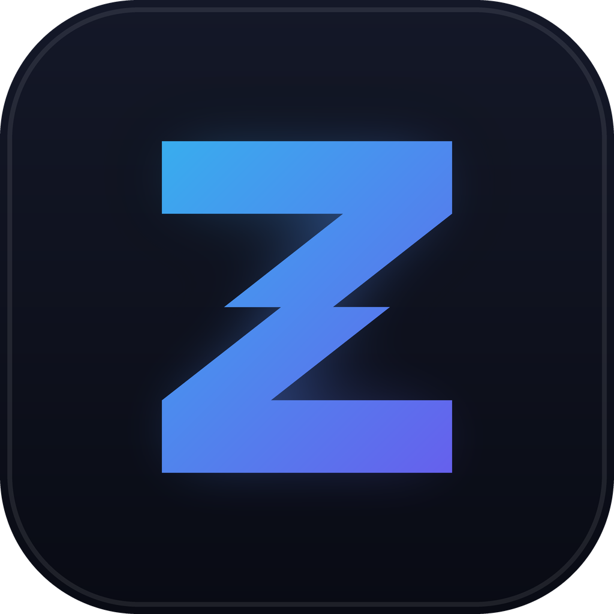

<div align="center">



# Zyro Client

A clean, smooth and fully themeable Minecraft: Java Edition client.

</div>

Zyro Client is a desktop launcher plus an in-game client mod. Open Zyro, pick a version and press **Launch**: you get Minecraft with the Zyro main menu, a customisable HUD and quality-of-life modules, in its own separate game folder.

## Features

**Launcher**
- One product, two versions: **Zyro Client 26.3** and **Zyro Client 1.21.11** (Fabric).
- Themes: Zyro, Void (AMOLED), Aurora, Ember, Sakura and Minecraft, each in dark/light where it makes sense.
- Accent colour picker with quick swatches, full theme editor, theme import/export.
- Independent: version metadata comes from Mojang and Fabric; runtime mods (Fabric API, Sodium) come from Modrinth. No telemetry by default.

**In game** (`mods/zyro-client`)
- Zyro main menu, Zyro window title and icon.
- HUD: FPS, CPS, keystrokes, coordinates, ping, speed, clock, armor; drag to move, scroll to resize, per-element colours, chroma, background opacity.
- Modules: zoom (hold C, cinematic), toggle sprint.
- **Right Shift** opens Zyro settings.

## Building

Requirements: Rust (stable), Visual Studio Build Tools (C++), JDK 21 and JDK 25.

```sh
# Game mod (both versions)
cd mods/zyro-client/v1_21_11 && ./gradlew build
cd ../v26_3 && ./gradlew build
# copy the jars into packages/zyro_core/assets/mods/ (zyro-client-<version>.jar)

# Launcher
SQLX_OFFLINE=true cargo build -p zyro_app --release
```

Optional build-time settings: `ZYRO_MSA_CLIENT_ID` (Microsoft sign-in app), `ZYRO_UPDATER_ENDPOINT`, `ZYRO_DISCORD_CLIENT_ID`, `ZYRO_SENTRY_DSN`.

Branding assets are generated from `branding/` (`generate.py`, `mod_assets.py`, `background.py`).

## License and credits

Zyro Client is free software under the **GNU General Public License v3.0 only** (see [LICENSE](LICENSE)).

It is a fork of [OneLauncher](https://github.com/Polyfrost/OneLauncher) by Polyfrost and contributors, also GPL-3.0. Polyfrost branding (logos, artwork) has been removed; see [ATTRIBUTION.md](ATTRIBUTION.md) for third-party notices.

Zyro Client is not affiliated with, endorsed by, or associated with Mojang Studios or Microsoft. Minecraft is a trademark of Mojang Studios.
